<div align="center">

# Linguistic DNA

**An evidence-first graph of how words are related: built around India's languages, now reaching 3,489 searchable languages from the Eurasian steppe to the Pacific.**

Type a word in any of 9 Brahmic scripts, in romanisation, or in Cyrillic, Latin, Greek and other scripts, and follow its documented links:
what it was inherited from, borrowed from, built from, or is cognate with, with the source for every claim.

[](https://github.com/Vaidurya-s/Linguistic-DNA/actions/workflows/ci.yml)


[What it does](#what-it-does) ·
[At a glance](#at-a-glance) ·
[Gallery](#gallery) ·
[Quick start](#quick-start) ·
[Open data vs research use](#open-data-vs-research-use) ·
[How to cite](#how-to-cite) ·
[Docs](docs/README.md)

<a href="docs/media/demo.mp4">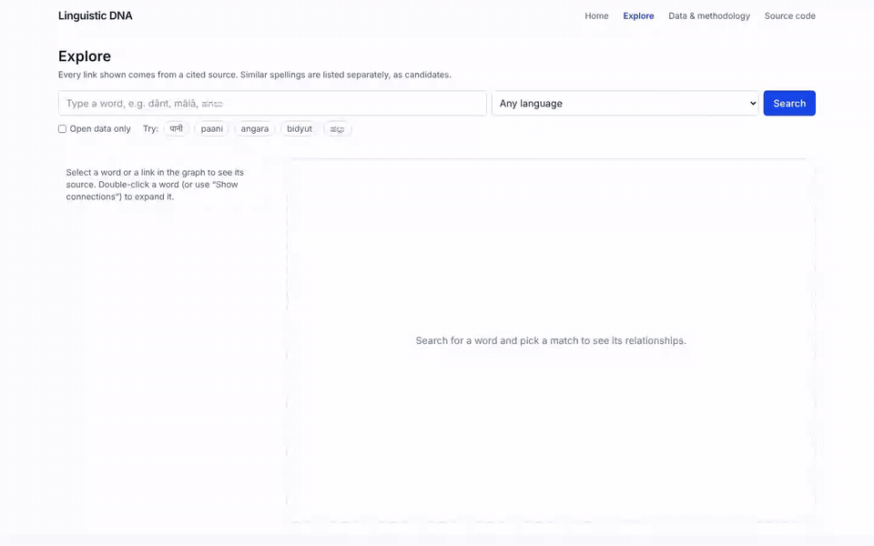</a>

<sub>39-second walkthrough (click for the <a href="docs/media/demo.mp4">MP4</a>). Kannada <i>nīru</i> → Proto-Dravidian <i>*kaṇ-ṇīr</i> → the CDIAL record saying Sanskrit <i>nīrá</i> was borrowed from it; then Hindi पानी → Prakrit पाणीअ → Sanskrit पानीय from Wikidata.</sub>

</div>

---

## What it does

**Search the way people actually write.** पानी, *paani*, *pānī* and ਪਾਣੀ land on the same records. A rule-based ISO 15919 romaniser covers Devanagari, Bengali-Assamese, Gurmukhi, Gujarati, Odia, Tamil, Telugu, Kannada and Malayalam, and casual spellings resolve through Dakshina and Aksharantar spelling pairs. Each match says how it was found, for example `paani → पानी (dakshina) → pānī`.

**Every edge is a sentence with a citation.** Links are typed and directed, and each one opens to its evidence: the dataset, the work it cites, the entry or page, and the licence. "ਪਾਣੀ (Punjabi) comes from पाणीअ (Prakrit)" is a claim you can check, not a picture.

**Resemblance is never drawn as relationship.** Words that merely look alike are listed separately as *candidates*, with a score that is explicitly not a measure of relatedness. Reconstructed forms keep their asterisk and are never shown as attested.

**From India to the steppe, and beyond.** Every Glottolog language has a record, and any language with at least 200 words becomes searchable. Slavic, Baltic, Iranian, Turkic, Mongolic and Uralic languages, and their reconstructed ancestors, connect to Sanskrit and the languages of India through Wiktionary etymologies, expert cognate sets (IE-CoR, NorthEuraLex) and, on your own machine, the StarLing etymological databases (Pokorny, Vasmer, Altaic). Russian alone has 193,952 words and 72,214 of them have documented links.

**Built for research, careful about redistribution.** The richest sources on Indo-Aryan and Dravidian word history (Turner's CDIAL, Burrow & Emeneau's DEDR) are still in copyright. They are used for research with a citation on every record, but never committed here or put in the downloadable open data. An *Open data only* switch shows what remains without them.

## At a glance

> [!NOTE]
> Headline numbers, as of **2026-10-30**. They change as sources are added: `make db-size` prints the research database's words and links per dataset, and `data/public_seed/manifest.json` describes the seed.

| | Open public seed<br/><sub>`data/public_seed`, committed</sub> | Research database<br/><sub>`make research-db`, built locally</sub> |
|---|---:|---:|
| Words | **521,448** | **8,480,391** |
| &nbsp;&nbsp;from open-licensed / research-use sources | 521,448 / 0 | 7,101,577 / 1,378,814 |
| Documented, cited relationships | **221,594** | **4,560,323** |
| &nbsp;&nbsp;from open-licensed / research-use sources | 221,594 / 0 | 3,746,248 / 814,075 |
| Evidence rows (citations with locators) | 221,594 | 4,623,616 |
| Datasets with words or profiles | 12 | 147 |
| Sources cited on individual records | 12 | 541 |
| Concepts linking meanings (Concepticon, wordnet ILI) | 1,393 | 121,692 |
| Language profile values (WALS, PHOIBLE) | — | 151,380 |
| Transliteration spelling pairs | 947,189 | 947,189 |
| Language records / searchable languages | 728 / 25 | 9,651 / **3,489** |
| Size | ≈ 55 MB compressed, ≈ 680 MB loaded | ≈ 9.8 GB |

<sub>The committed seed was built before the global imports; `make public-seed` rebuilds it from the open-licensed part of the research database. The research column does not yet include the StarLing databases, which are downloaded and imported on your own machine. `make full-db` (Wiktionary and Wikidata in every language) adds an estimated 5–8 million words and 8–12 million links; see [`REQUIREMENTS.md`](REQUIREMENTS.md).</sub>

**3,489 searchable languages.** A language becomes searchable when it has at least 200 words; `refresh-languages` gives every Glottolog language (8,594 languages in 4,853 families) one record, whichever sources it comes from. The explorer's language box filters them by name or family.

**25 configured languages** get the most care: native-script search, romanisation rules and transliteration aliases (configured in [`data/config/languages.csv`](data/config/languages.csv)):

| Group | Languages |
|---|---|
| Indo-Aryan | Assamese, Awadhi, Bengali, Bhojpuri, Dogri, Gujarati, Hindi-Urdu, Konkani, Maithili, Marathi, Marwari, Nepali, Odia, Punjabi |
| Dravidian | Kannada, Malayalam, Tamil, Telugu |
| Sino-Tibetan | Bodo |
| Historical and reference | Sanskrit, Pali, Prakrit, Apabhramsha, Ashokan Prakrit, Old Indo-Aryan (CDIAL headwords) |

<p align="center">
  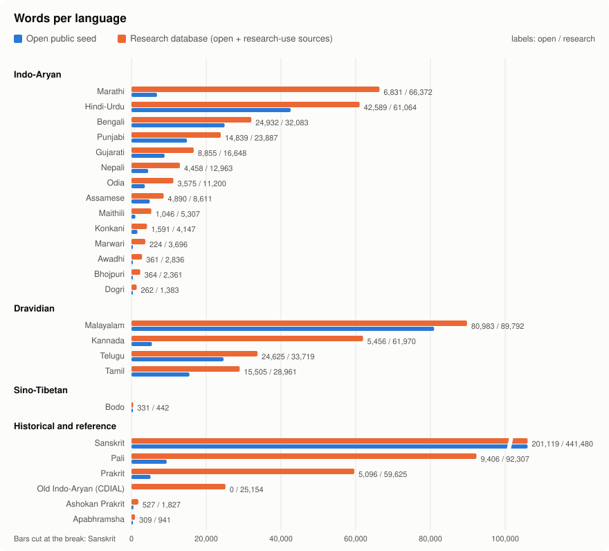
</p>

<sub>Generated by `scripts/coverage_chart.py` from read-only queries of the research database on 2026-10-30; each section has its own scale. Coverage is very uneven, and the app shows it as such: the live per-language table is on the app's *Data &amp; methodology* page.</sub>

## A word's history, as the sources tell it

Two chains from the research database, every step a stored relationship with its evidence row. Blue nodes are open data; orange nodes come from research-use sources.

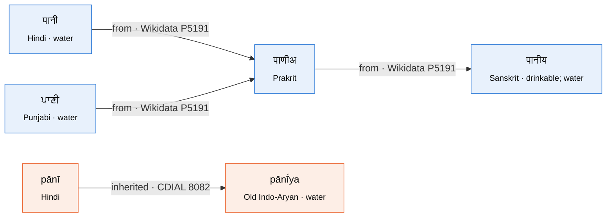

The Wikidata steps cite the reference recorded on each statement (`stated in Q115652507, p. 452`). Wikidata's "derived from" does not say whether a word was inherited or borrowed, so the app shows it as **from**, not as either.

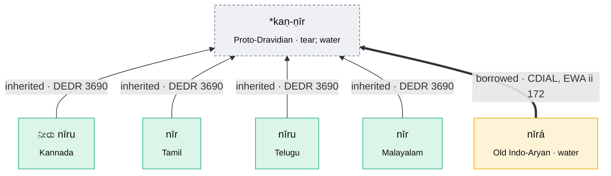

Turner's CDIAL records Sanskrit *nīrá* "water" as a borrowing from the Dravidian word that DEDR reconstructs as *\*kaṇ-ṇīr*. Both claims reach the app through Jambu, cited per record.

### Across the steppe

"Widow" in Russian, Sanskrit, Persian and Latin goes back to one Proto-Indo-European word. Hungarian took its word from Indo-Iranian, one of the contacts between Indo-Iranian and Uralic speakers on the steppe. Every arrow is a stored Wiktionary link with its page cited.

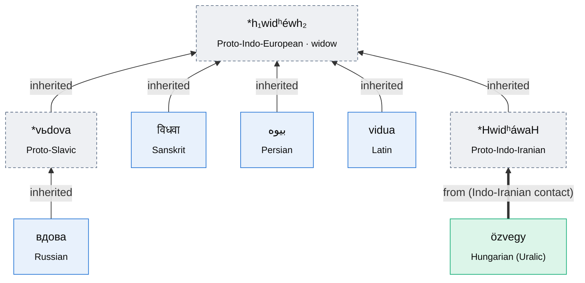

The same pattern runs through the basic vocabulary: "hundred" is Hindi सौ, Sanskrit शत, Avestan *sata*, Persian صد, Ossetian сӕдӕ, Lithuanian *šimtas* and Russian сто, all from *\*ḱm̥tóm*.

## How the links are typed

Each source's own label is kept beside the normalised type, so nothing is silently reinterpreted. Counts are relationships in the research database / committed open seed (2026-10-30).

| Edge in the graph | Type | Reads as | Research / open seed |
|---|---|---|---:|
|  | `has_component` | compound or phrase *A* contains *B* | 1,575,938 / 50,231 |
|  | `inherited_form` | *A* is a regular descendant of *B* | 1,250,550 / 29,646 |
|  | `cognate` | *A* and *B* share an inherited origin (undirected) | 990,029 / 93,860 |
|  | `borrowed_from` | *A* was borrowed from *B* | 401,148 / 30,531 |
|  | `etymon` | *A* comes from *B*; inherited or borrowed is not stated | 193,160 / 16,881 |
|  | `related_form` | the source relates them without saying how | 52,863 / 0 |
|  | `derived_form` | *A* is derived from *B* (affixation, extension) | 49,091 / 0 |
|  | `variant_of` | *A* is a documented variant of *B* | 36,193 / 0 |
|  | `calque_or_loan_translation` | *A* is a loan translation of *B* | 11,333 / 418 |
|  | `contact_influence` | *A* was influenced by *B* through contact | 18 / 0 |

Meaning is kept apart from history: words that share a meaning meet through shared concepts (Concepticon and the wordnets' interlingual index, 5.5 million word–concept links), never through drawn edges. Language profiles (WALS features, PHOIBLE sound inventories) are served per language at `GET /api/v1/languages/{id}/profile`.
| *listed, never drawn* | similarity candidates | similar spelling or sound, **not evidence of relation** | — |

## Gallery

<table>
  <tr>
    <td width="50%"><a href="docs/media/explore-hindi-paani-chain.png">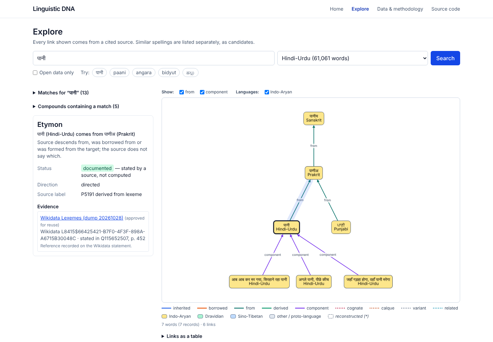</a><br/><sub><b>A chain from open data.</b> Hindi पानी → Prakrit पाणीअ → Sanskrit पानीय, with the Wikidata statement and its reference.</sub></td>
    <td width="50%"><a href="docs/media/evidence-borrowed-nira-cdial.png">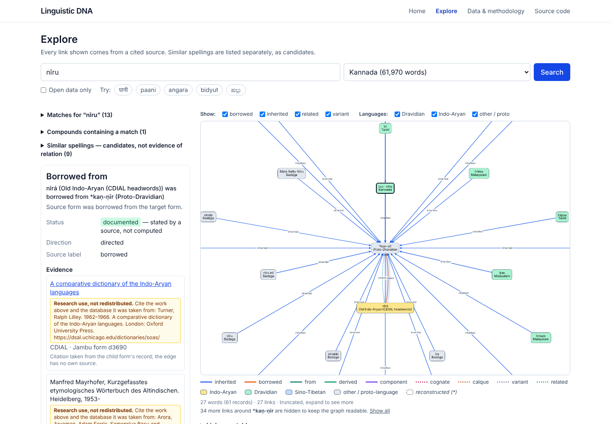</a><br/><sub><b>Every edge opens to its evidence.</b> <i>nīrá</i> borrowed from <i>*kaṇ-ṇīr</i>: CDIAL, Mayrhofer's EWA, and the research-use note.</sub></td>
  </tr>
  <tr>
    <td><a href="docs/media/explore-kannada-niru-proto-dravidian.png">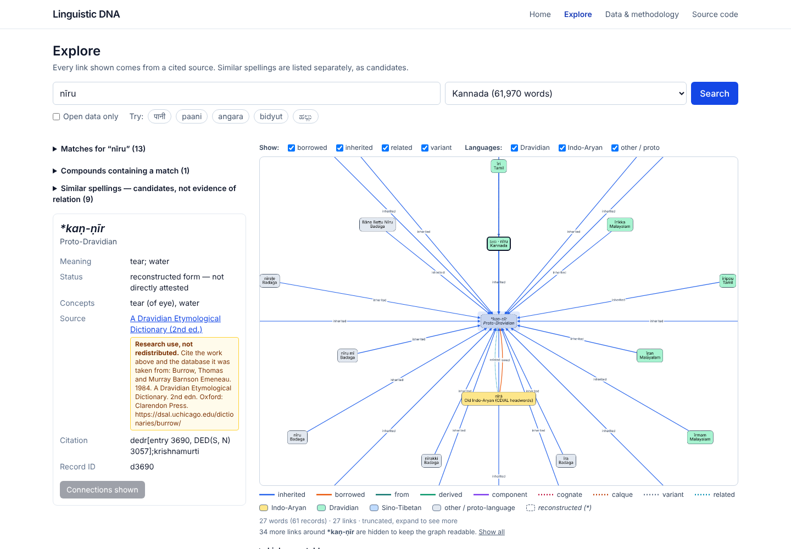</a><br/><sub><b>Expanding a reconstruction.</b> Descendants of Proto-Dravidian <i>*kaṇ-ṇīr</i> across Dravidian, from DEDR via Jambu.</sub></td>
    <td><a href="docs/media/open-data-cognates-jibh.png">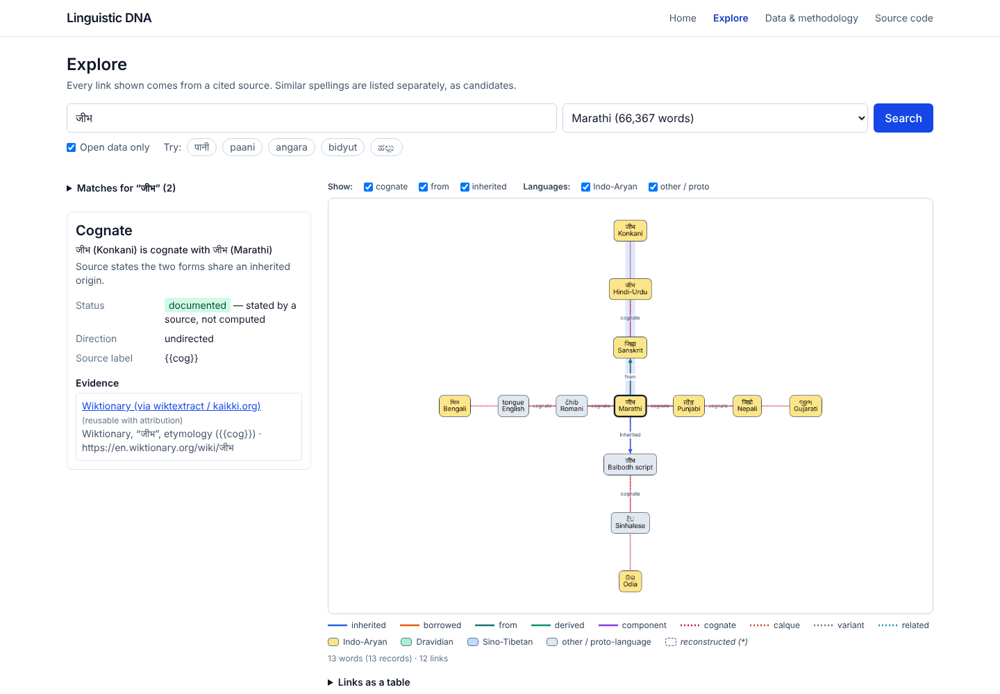</a><br/><sub><b>Open data only.</b> Marathi जीभ "tongue": cognates and its Sanskrit source, all from openly licensed data.</sub></td>
  </tr>
  <tr>
    <td><a href="docs/media/explore-punjabi-paani.png">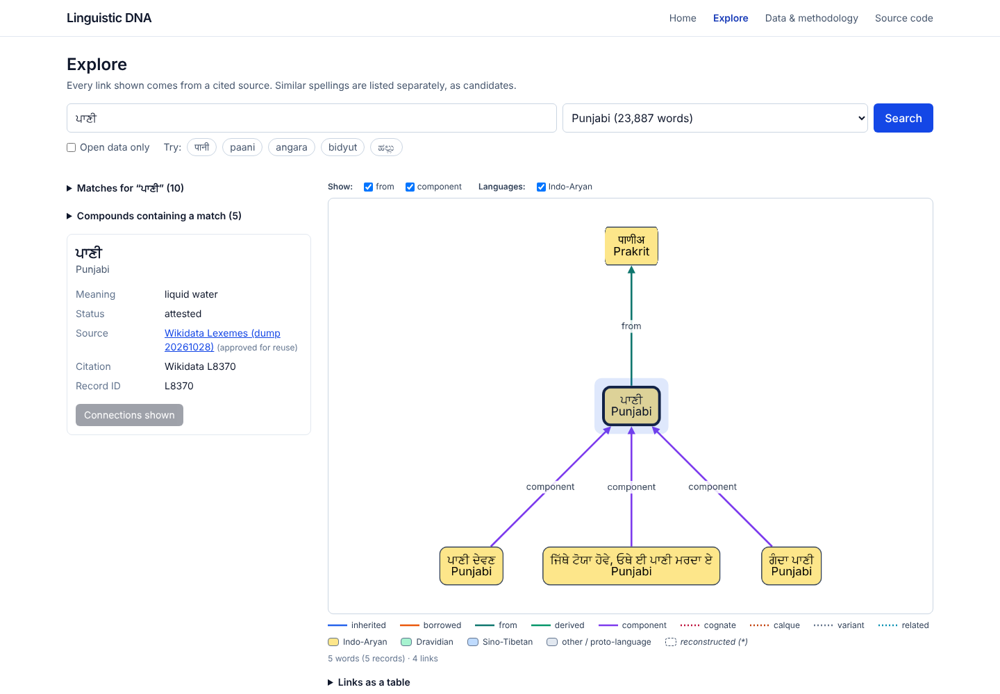</a><br/><sub><b>Native-script search, one language.</b> Punjabi ਪਾਣੀ, its Prakrit source and the compounds and sayings built on it.</sub></td>
    <td><a href="docs/media/explore-kannada-hallu.png">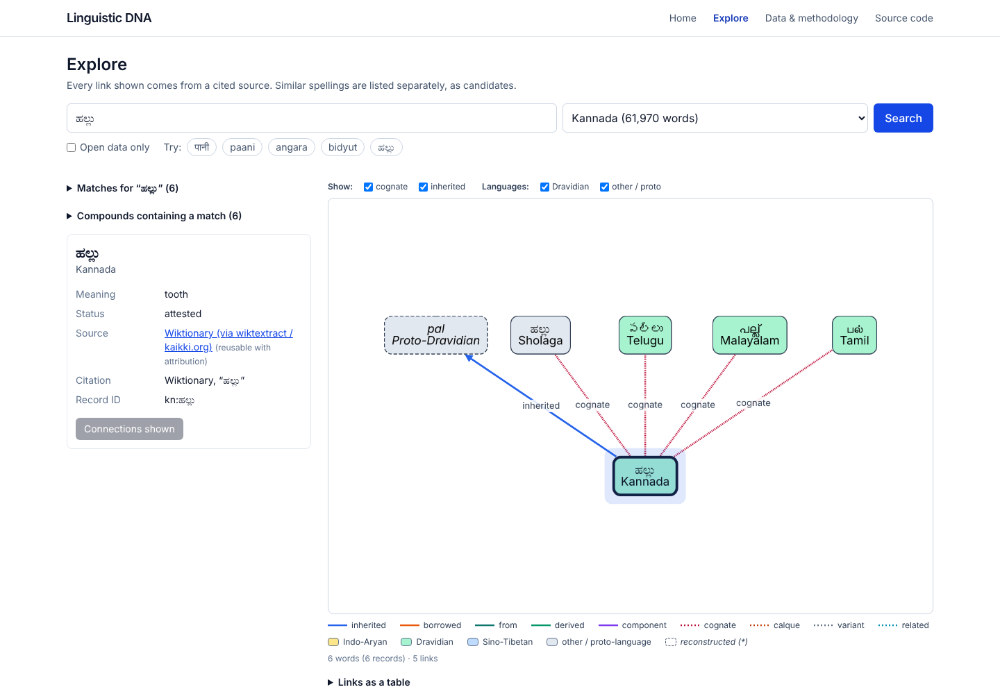</a><br/><sub><b>Kannada script in, Dravidian history out.</b> ಹಲ್ಲು "tooth": inherited from Proto-Dravidian <i>pal</i> (reconstructed), with cognates in Telugu, Malayalam, Tamil and Sholaga (Wiktionary).</sub></td>
  </tr>
  <tr>
    <td colspan="2"><a href="docs/media/explore-russian-vdova.png">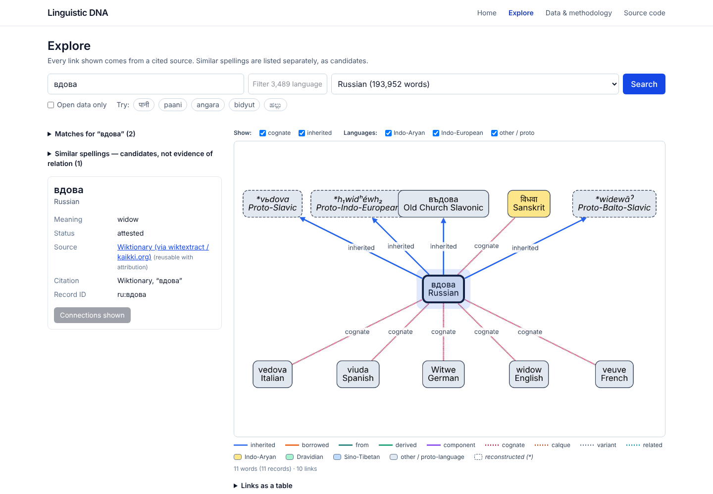</a><br/><sub><b>Beyond India: the steppe languages.</b> Russian вдова "widow": inherited through Old Church Slavonic, Proto-Slavic and Proto-Balto-Slavic from Proto-Indo-European, with Sanskrit विधवा and the Romance and Germanic words as cognates (Wiktionary).</sub></td>
  </tr>
  <tr>
    <td><a href="docs/media/home.png">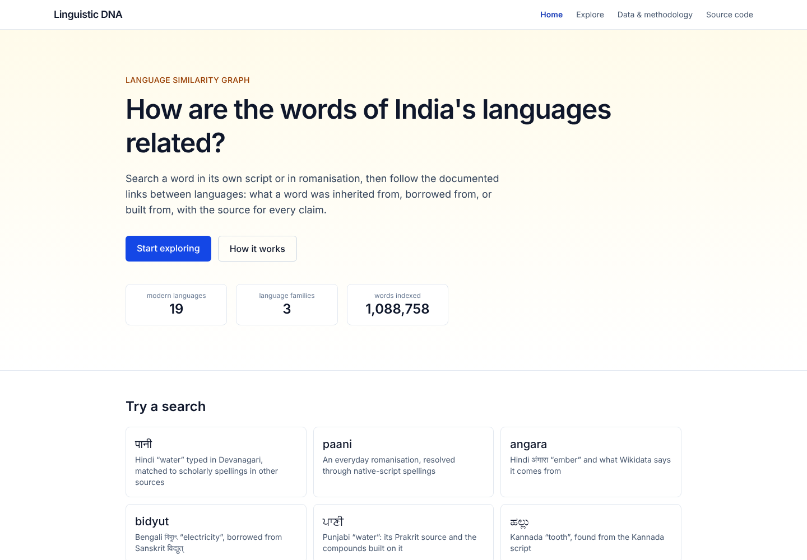</a><br/><sub><b>Landing page</b> with suggested searches.</sub></td>
    <td><a href="docs/media/methodology-how-to-cite.png">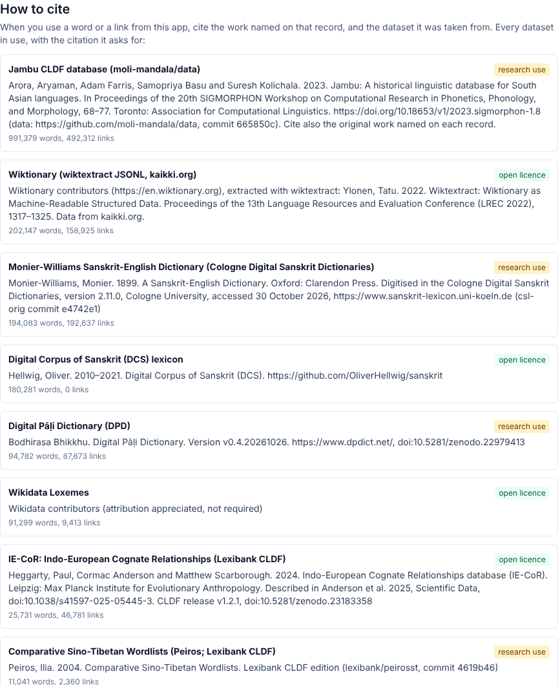</a><br/><sub><b>How to cite.</b> Every dataset with the citation it asks for, research-use or open, and record counts.</sub></td>
  </tr>
  <tr>
    <td><a href="docs/media/methodology-coverage.png">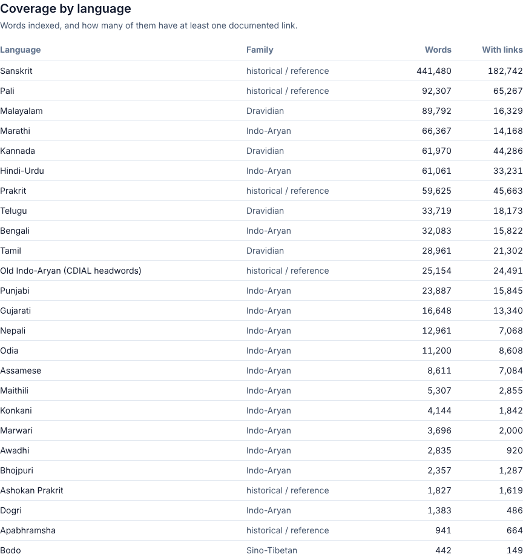</a><br/><sub><b>Live coverage table</b> on the methodology page: words and words with links, per language.</sub></td>
    <td align="center"><a href="docs/media/mobile-explore.png">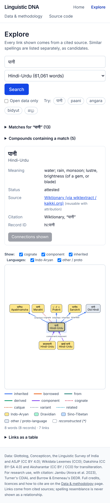</a> <a href="docs/media/mobile-home.png">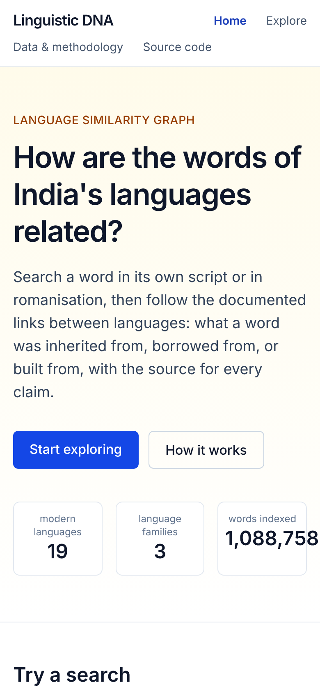</a><br/><sub><b>Works on a phone.</b></sub></td>
  </tr>
</table>

<p align="center">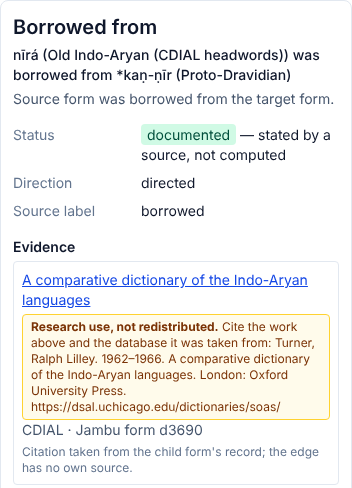<br/><sub>The note every research-use record carries: cite the work, and the database it came from.</sub></p>

## Open data vs research use

Every dataset is a row in a machine-readable licence audit, [`data/manifests/dataset_audit.csv`](data/manifests/dataset_audit.csv), explained in [`docs/DATASET_LICENCE_AUDIT.md`](docs/DATASET_LICENCE_AUDIT.md). The importers, the validator and the seed builder all read it, so "may this be published?" is a query, not a judgement call made at release time.

| Decision | Datasets | Where it can appear |
|---|---|---|
| **APPROVED** / **APPROVED WITH CONDITIONS** | Glottolog, Concepticon, LSI, ASJP, Wikidata Lexemes, Wiktionary (wiktextract), IE-CoR, IELex, DravLex, NorthEuraLex, Hale's Nepal wordlists, about 125 more Lexibank CLDF wordlists (among them ABVD, the Austronesian Comparative Dictionary, SEABOR and WOLD's loanwords), the Open Multilingual Wordnet (32 wordnets), WALS and PHOIBLE (language profiles), Digital Corpus of Sanskrit lexicon, Dakshina, Aksharantar (approved components) | Everywhere, including the committed open seed, with attribution in [`data/public_seed/ATTRIBUTION.md`](data/public_seed/ATTRIBUTION.md) |
| **RESEARCH USE** | Jambu (and through it Turner's CDIAL, Burrow & Emeneau's DEDR and about 570 other works), Monier-Williams 1899 (Cologne), Digital Pāḷi Dictionary, Peiros' Sino-Tibetan wordlists and six other non-commercial Lexibank wordlists, the StarLing etymological databases (Pokorny, Vasmer, Indo-European, Altaic, Dravidian, North Caucasian, Sino-Tibetan and more) | The research database and a research deployment, with a citation on every record. **Never** in this repository or the open seed |
| **BLOCKED** | everything unverified | Nowhere. `validate --research` fails on it |

In the app:
- research-use records carry a **"Research use, not redistributed"** note with the citation of the work and of the database it came from;
- **Open data only** in Explore hides research-use data from search and from the graph;
- `GET /api/v1/citations` lists every dataset with its required citation, and every work cited by individual records with record counts.

## Quick start

You need Python 3.12+, Node 22, and Docker (or your own PostgreSQL 16 with `pg_trgm`). [`REQUIREMENTS.md`](REQUIREMENTS.md) lists everything to install on Linux, with the commands; [`docs/DEPLOYMENT.md` § 6](docs/DEPLOYMENT.md#6-running-it-on-your-own-linux-machine) walks through running it on your own Linux machine, including sharing it through a tunnel.

```bash
make setup db-up migrate    # venv + npm install, Postgres in Docker, schema
```

**Open data, no downloads.** Load the committed public seed:

```bash
make load-public-seed
```

**Or rebuild the open data from upstream.** Every input is pinned by commit or SHA-256 in [`data/manifests/downloads.json`](data/manifests/downloads.json):

```bash
make fetch-data import-open validate
```

**The research database** adds the research-use sources, fetched from their own upstream (never from this repository):

```bash
make fetch-dev-data
make research-db            # open imports, research imports, Glottolog, re-key, validate --research
```

The research imports include the **StarLing etymological databases** (Starostin's *Tower of Babel*), with Pokorny's and Vasmer's dictionaries, Indo-European, Germanic, Baltic, Altaic, Dravidian, North Caucasian, Sino-Tibetan, Chukchee-Kamchatkan, Kartvelian and Yeniseian etymologies. `make fetch-dev-data` downloads their 2005 archives (about 15 MB) from starlingdb.org on your machine; no StarLing software is needed. `make import-starling` re-runs just that import and lists any field names or abbreviations it could not assign to a language in `reports/starling_unmapped.csv` ([details](docs/DATA_PIPELINE.md)).

**Everything, in every language** (about 5,000 languages, with Wiktionary's full etymologies and descendant lists; about 100 GB of free disk recommended, see [`REQUIREMENTS.md`](REQUIREMENTS.md)):

```bash
make full-db                # all downloads, every import in every language, checks, size report
```

**Run the app** with `make serve-api` and `make serve-web` (a production build on :5173), or in development mode (the API reads `DATABASE_URL`, default `postgresql+psycopg://postgres@localhost:5432/lsg`):

```bash
cd backend && .venv/bin/uvicorn app.main:app --reload    # API on :8000, OpenAPI docs at /docs
```

```bash
cd frontend && npm run dev                                # site on :5173, proxies /api to :8000
```

Then open <http://localhost:5173/#/explore?q=पानी&lang=hin>. There is no public hosted instance yet; [`docs/DEPLOYMENT.md`](docs/DEPLOYMENT.md) covers a Docker API plus a static site (GitHub Pages workflow included), and how to host the research version.

<details>
<summary><b>More make targets</b></summary>

| Target | What it does |
|---|---|
| `make validate` / `validate-public` / `validate-research` | Provenance and data-quality checks; the public mode fails on anything not approved, the research mode on any uncited research-use record |
| `make coverage` | Per-language coverage table in `reports/coverage.md` |
| `make benchmark` | Runs the relationship benchmark in `data/benchmark/` (results stay provisional until reviewed by a linguist) |
| `make public-seed` | Exports approved rows only to `data/public_seed/`, with `ATTRIBUTION.md` and a checksummed `manifest.json` |
| `make research-dump` | `pg_dump` of the research database into the git-ignored `data/research_dump/`, for a hosted research instance |
| `make test` / `make lint` | pytest against PostgreSQL and vitest; ruff, oxlint and tsc |

Full pipeline: [`docs/DATA_PIPELINE.md`](docs/DATA_PIPELINE.md).
</details>

<details>
<summary><b>API</b></summary>

All under `/api/v1`; interactive docs at `http://localhost:8000/docs`.

| Endpoint | Returns |
|---|---|
| `GET /search?q=…&language_id=…` | whole-word matches (with how each was found), stems and affixes, compounds, and spelling candidates |
| `GET /graph/{lexeme_id}` | the neighbourhood of a word: typed edges, capped for readability |
| `GET /lexemes/{id}`, `GET /relationships/{id}` | a word or a link with its source, citation and evidence |
| `GET /languages` | searchable languages with family, word and linked-word counts (open-only counts too) |
| `GET /languages/{id}/profile` | WALS features and PHOIBLE sound inventory of a language |
| `GET /citations` | every dataset's required citation and every cited work, with counts |
| `GET /health` | liveness |

Every search and graph call accepts `open_only=true`.
</details>

## How it is built

```mermaid
flowchart LR
  subgraph OPEN["Open, redistributable (audit: APPROVED)"]
    direction TB
    o1["Glottolog · Concepticon"]
    o2["Wikidata Lexemes · Wiktionary"]
    o3["IE-CoR · IELex · DravLex<br/>NorthEuraLex · Hale · LSI · ASJP"]
    o6["~125 more Lexibank wordlists<br/>(ABVD, ACD, SEABOR, WOLD)"]
    o7["Open Multilingual Wordnet<br/>WALS · PHOIBLE"]
    o4["DCS Sanskrit lexicon"]
    o5["Dakshina · Aksharantar<br/>(spelling pairs)"]
  end
  subgraph RES["Research use, cited per record"]
    direction TB
    r1["Jambu<br/>(CDIAL, DEDR, ~570 works)"]
    r2["Monier-Williams 1899"]
    r3["Digital Pali Dictionary"]
    r4["Peiros Sino-Tibetan<br/>+ 6 NC Lexibank sets"]
    r5["StarLing / Tower of Babel<br/>(Pokorny, Vasmer, Altaic …)"]
  end
  OPEN --> F["fetch_data.py<br/>pinned commits + sha256"]
  RES --> F
  F --> RAW[("data/raw<br/>git-ignored")]
  RAW --> IMP["Importers<br/>typed links + evidence"]
  AUD["dataset_audit.csv"] -. gates .-> IMP
  IMP --> DB[("Research database<br/>PostgreSQL 16 + pg_trgm")]
  DB --> V1{"validate --research"}
  DB --> SB["Seed builder<br/>approved rows only"]
  SB --> SEED[("data/public_seed<br/>committed")]
  SEED --> V2{"validate --public-seed"}
  V1 --> API["FastAPI"]
  V2 --> API
  API --> UI["React + Cytoscape"]
```

- **Back end:** FastAPI, SQLAlchemy and Alembic on PostgreSQL 16 with `pg_trgm`. Every word and link records the dataset it came from; every source points to an audit row. IDs are deterministic, so re-imports keep them.
- **Front end:** React 19, TypeScript, Vite, Tailwind and Cytoscape.js, with hash routes (`#/`, `#/explore?q=…&lang=…`, `#/methodology`), so it deploys as a static site. Graph shaping (merging duplicate records, filters, neighbour capping, edge sentences) is a pure, unit-tested module; the canvas only draws.
- **Search:** our own ISO 15919 romaniser for nine Brahmic scripts, with language-specific inherent-vowel and anusvara rules; whole words are kept apart from stems, affixes and compounds.

The design decisions are explained in [`docs/WRITEUP.md`](docs/WRITEUP.md).

<details>
<summary><b>Project structure</b></summary>

```text
backend/     FastAPI app, SQLAlchemy models, Alembic migrations, importers, validator, tests
frontend/    React + TypeScript + Vite + Tailwind + Cytoscape.js
data/
  config/      configured languages
  manifests/   licence audit, source manifest, pinned downloads
  public_seed/ the open seed: gzipped CSVs, ATTRIBUTION.md, manifest.json
  benchmark/   hand-picked relationship cases
  raw/         downloaded inputs (git-ignored)
scripts/     fetch_data.py and audit / fixture helpers
docs/        specification, architecture, licence audit, pipeline, deployment, write-up, media
```
</details>

## Roadmap

- [x] **Phase 1, data correctness and licensing.** Licence audit as data; provenance on every row; a public seed built only from approved data; exact matches separated from stems and compounds.
- [x] **Phase 2, scripts and graph.** Native-script and romanised search in 9 scripts; graph clutter control; eight more Devanagari languages (17 → 25).
- [x] **Phase 3, presentation.** Landing and methodology pages, write-up, Docker image and deployment docs.
- [x] **Research expansion.** Jambu in full, Wiktionary etymologies, expert cognate sets, Sanskrit and Pāli dictionaries, with per-record citations and the *Open data only* switch.
- [x] **Global expansion.** Every Glottolog language as one record; 130 Lexibank wordlists, the Open Multilingual Wordnet, WALS and PHOIBLE profiles, WOLD and ACD borrowings; the steppe corridor (Russian and its neighbours and ancestors) in Wiktionary and Wikidata; 3,489 searchable languages.
- [x] **Everything on your own machine.** `make full-db` (Wiktionary and Wikidata in every language, with descendant lists) and the StarLing etymological databases; Linux setup in [`REQUIREMENTS.md`](REQUIREMENTS.md).
- [ ] **Translation and profile panels** in the app for the meaning links and language profiles already in the database.
- [ ] **Rebuild the open seed** from the global open data, published as release assets (it outgrows a git repository).
- [ ] **Hosted demo** of the open seed and of the research version ([`docs/DEPLOYMENT.md`](docs/DEPLOYMENT.md)).
- [ ] **More scripts and languages:** Urdu, Kashmiri and Sindhi (Perso-Arabic), Santali (Ol Chiki), Manipuri (Meitei Mayek); then Tulu, Kodava, Kurukh, Khasi, Mizo.
- [ ] **Linguist review** of the benchmark, and a separately drawn *candidate* layer for computed similarity.

The release gate and its status are tracked in [`docs/DATASET_LICENCE_AUDIT.md`](docs/DATASET_LICENCE_AUDIT.md) §7.

## How to cite

When you use a word or a link from this project, **cite the work named on that record and the dataset it was taken from.** The exact citation for every dataset is in [`data/manifests/dataset_audit.csv`](data/manifests/dataset_audit.csv), served at `GET /api/v1/citations` and shown on the app's *Data &amp; methodology* page. The two dictionaries behind most Indo-Aryan and Dravidian word histories here:

> Turner, Ralph Lilley. 1962–1966. *A comparative dictionary of the Indo-Aryan languages*. London: Oxford University Press.
>
> Burrow, Thomas and Murray Barnson Emeneau. 1984. *A Dravidian Etymological Dictionary*. 2nd edn. Oxford: Clarendon Press.

and the database through which they reach this project:

> Arora, Aryaman, Adam Farris, Samopriya Basu and Suresh Kolichala. 2023. Jambu: A historical linguistic database for South Asian languages. *Proceedings of the 20th SIGMORPHON Workshop*, 68–77. ACL. doi:10.18653/v1/2023.sigmorphon-1.8

To cite this software, name the repository and the commit you used:

```text
Linguistic DNA: an evidence-first graph of word relationships, from the languages of India to the Eurasian steppe and beyond.
https://github.com/Vaidurya-s/Linguistic-DNA, commit <hash>.
```

**Licensing.** The open seed carries the terms of its sources (CC0, CC BY 4.0, CC BY-SA 4.0 for Dakshina- and Wiktionary-derived rows, and each wordnet's own licence), listed in [`data/public_seed/ATTRIBUTION.md`](data/public_seed/ATTRIBUTION.md). The repository does not yet include a licence file for its code.

## Acknowledgements

This project stands on the work of others: the compilers of CDIAL and DEDR; the Jambu team, who made decades of South Asian historical linguistics machine-readable; Glottolog, Concepticon and the Lexibank / CLDF community (LSI, ASJP, IE-CoR, IELex, DravLex, NorthEuraLex, Hale's Nepal, Peiros, ABVD, ACD, WOLD and the authors of the other 120 wordlists); the Open Multilingual Wordnet and the wordnets it gathers; WALS and PHOIBLE; Wikidata and Wiktionary contributors, and wiktextract / kaikki.org; the Digital Corpus of Sanskrit, the Cologne Digital Sanskrit Dictionaries and the Digital Pāḷi Dictionary; Sergei and George Starostin and the Tower of Babel (StarLing) project; and Google Research's Dakshina and AI4Bharat's Aksharantar for transliteration data.

<div align="center"><sub>Surface resemblance is not proof of common ancestry. Every documented relationship here traces to a source.</sub></div>
