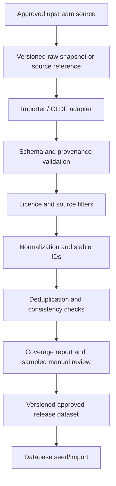

# Dataset and Licensing Plan — Language Similarity Graph

## 1. Purpose

The project’s credibility depends on data quality and provenance. This document defines which sources to investigate, what to extract, how to preserve citations, and how to avoid redistributing content without permission.

**Rule:** availability online does not automatically mean that content can be redistributed in a public application.

## 2. Source strategy

### 2.1 Jambu — first source to investigate

- Website: <https://aryaman.io/jambu/>
- Data repository: <https://github.com/moli-mandala/data>
- Related publication: <https://aclanthology.org/2023.sigmorphon-1.8/>

Why investigate it first:

- focuses on South Asian linguistic data;
- brings together word forms and historical/etymological resources;
- provides structured data and conversion tooling, including CLDF-oriented resources;
- can reduce the amount of manual dictionary data entry.

Tasks:

1. Clone or download the repository under its terms.
2. Read its README, data documentation, contribution notes, and source-level licence metadata.
3. Inspect schema definitions and identify fields for language, form, concept/gloss, cognate judgments, etymology, source, and reconstructed status.
4. Produce a coverage report for the selected languages.
5. Identify each source that can be redistributed, each source requiring attribution or separate permission, and each source that must be excluded.
6. Build a small approved data slice and compare its records against the original source.

Do not infer that all records share the same licence. A wrapper or aggregation repository may contain multiple underlying works with different reuse terms.

### 2.2 Glottolog — language identity and classification

- Main site: <https://glottolog.org/>
- Downloads: <https://glottolog.org/download>

Use for:

- stable identifiers such as Glottocodes;
- language names and alternate names;
- family/classification relationships;
- bibliographic metadata and language identity checks.

Check the current release terms and attribution requirements when importing. Keep classification relationships distinct from lexical etymology.

### 2.3 CLDF — interchange conventions

- Specification: <https://cldf.clld.org/>

Use CLDF-compatible importers when the source provides CLDF, especially for wordlists and cognate judgments. CLDF is a data convention and schema ecosystem, not a guarantee that all datasets are licensed alike. Licence checks remain source-specific.

### 2.4 AI4Bharat / IndicNLP — script and transliteration support

- AI4Bharat transliteration resources: <https://ai4bharat.iitm.ac.in/areas/xlit/>
- IndicXlit: <https://indicnlp.ai4bharat.org/indic-xlit/>

Investigate transliteration datasets/models to support common romanizations and native-script input. Inspect the exact licence for the model code, weights, and training/evaluation data independently. Do not assume that the model's software licence covers all associated data.

### 2.5 Digital Dictionaries of South Asia (DDSA)

- Dictionaries: <https://dsal.uchicago.edu/dictionaries/>

Potential use:

- verify definitions and lexical forms;
- locate historical dictionary sources;
- manually inspect etymological claims and source references.

Do not scrape and redistribute whole entries merely because they are searchable. Some individual works include explicit restrictions. Prefer links and citations or obtain permission where required.

### 2.6 Bharatavani

- Portal: <https://bharatavani.in/>

Potential source for multilingual dictionary and language material. Evaluate availability, machine-readable access, coverage, attribution, and reuse terms before building an importer.

## 3. Proposed initial language coverage

| Group | Target languages |
|---|---|
| Indo-Aryan | Hindi, Bengali, Marathi, Gujarati, Punjabi, Odia, Assamese |
| Dravidian | Tamil, Telugu, Kannada, Malayalam |
| Historical/reference | Sanskrit and documented Prakrit forms where the approved data supports them |

This is a product target, not an assumption about data coverage. At the end of the first audit, publish a per-language coverage table with at least:

- count of lexical forms;
- count of concepts/glosses;
- count of source-backed historical relationships;
- count of records with transliterations;
- count of records with pronunciation/IPA;
- licence/reuse status;
- known coverage gaps.

If a language has only a small number of reliable forms, show that limitation rather than implying parity with better-covered languages.

## 4. Data fields to preserve

For every imported lexical record, retain as much of the following as available:

- original source identifier;
- original form and normalized search form;
- language and variety identifiers;
- gloss/meaning and concept identifier;
- transcription or pronunciation;
- reconstructed vs attested status;
- cognate-set identifier or etymological relation;
- source title, author/editor, year, edition, page/entry locator;
- source URL;
- source dataset release/version;
- data licence and attribution text;
- transformation steps applied during import.

Never discard provenance during normalization. If two sources disagree, preserve the separate source claims instead of silently merging them into one statement.

## 5. Data normalization rules

1. Preserve raw spelling and source representation.
2. Store a Unicode-normalized form for search, normally NFC, without overwriting the raw source field.
3. Keep transliteration in its own field and record the scheme if known.
4. Keep IPA/phonetic transcription separate from orthographic spelling.
5. Use stable internal IDs and preserve external IDs as aliases.
6. Model language, script, variety, lexeme, concept, and relationship as different entities.
7. Represent missing data as unknown/null, not as a fabricated value.
8. Keep reconstructed forms explicitly marked, conventionally using an asterisk in display where appropriate.
9. Do not assume that identical spellings in separate languages are cognates.
10. Deduplicate only when evidence supports identity; preserve homonyms and distinct senses.

## 6. Licence and provenance audit

Maintain a `source_manifest.csv` (or equivalent table) with these columns:

```text
source_id,title,author_or_editor,url,version,access_date,licence_name,
licence_url,attribution_text,redistribution_allowed,commercial_use_allowed,
derivatives_allowed,share_alike_required,permission_status,notes
```

For each source, select one status:

- `approved` — reuse/redistribution basis confirmed;
- `attribution_required` — usable only when stated terms are followed;
- `permission_required` — do not bundle unless permission is obtained;
- `unknown` — do not redistribute until clarified;
- `excluded` — not used in the deployed dataset.

Also track source-level restrictions where an aggregate dataset contains multiple underlying references. If legal interpretation is uncertain, exclude the relevant records from the public seed dataset and link to the source instead.

## 7. Dataset release pipeline



Raw restricted data must not be committed to the public repository. Store download instructions, checksums, version information, and source references instead when redistribution is not permitted.

## 8. Data quality checks

At minimum, validate:

- no relationship references a missing lexeme;
- no lexeme references an unknown language;
- no reconstructed form is treated as directly attested;
- each documented historical edge has provenance;
- each candidate edge identifies its generating method;
- relationship type and direction are internally consistent;
- no source is labelled reusable without a recorded licence/permission decision;
- Unicode normalization does not erase meaningful distinctions;
- exact duplicates are reviewed rather than blindly removed;
- coverage reports can be reproduced from the released data.

## 9. Historical-text data (deferred)

Only introduce text corpora after the core lexical graph is reliable. For each corpus, record licence, edition, provenance, language/variety, dating method, and passage locator. Distinguish:

- a dated attestation found in a corpus;
- the earliest attestation known to a particular reference work;
- the earliest attestation found by this project's search.

These statements are not interchangeable. Corpus absence is not proof that a word did not exist before the first indexed occurrence.

## 10. Data acquisition checklist

- [ ] Inspect Jambu repository schema and version.
- [ ] Write a per-language coverage report.
- [ ] Identify upstream source and licence for every field/record class.
- [ ] Inspect Glottolog current release and attribution terms.
- [ ] Evaluate transliteration model/data licence separately.
- [ ] Decide which DDSA/Bharatavani materials can be cited, queried, or reused.
- [ ] Build an approved small sample before bulk import.
- [ ] Add dataset version and provenance to every imported release.
- [ ] Publish an accurate Data Sources and Limitations page.
