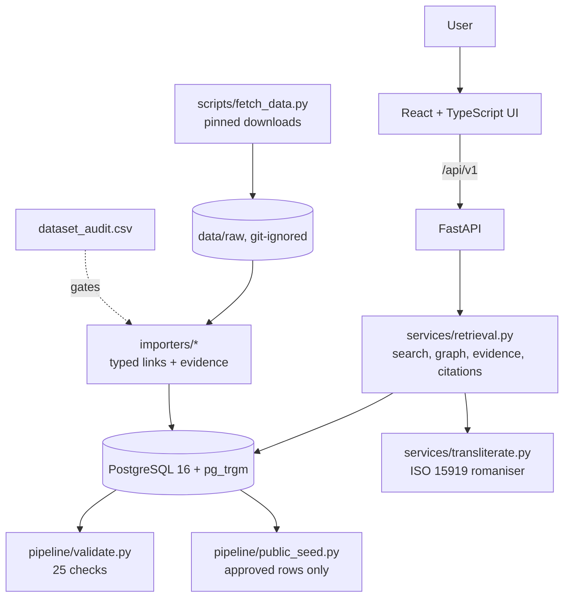

# Technical Architecture

How Linguistic DNA is built. For why the design is the way it is, see [`WRITEUP.md`](WRITEUP.md); for the data flow and commands, [`DATA_PIPELINE.md`](DATA_PIPELINE.md). This page describes the system as it stands, not the original proposal ([`PROJECT_SPECIFICATION.md`](PROJECT_SPECIFICATION.md) and [`DEVELOPMENT_ROADMAP.md`](DEVELOPMENT_ROADMAP.md) keep that).

## 1. Stack

| Layer | Choice | Role |
|---|---|---|
| Front end | React 19, TypeScript, Vite, Tailwind CSS | Search, graph interaction, evidence, methodology pages |
| Graph | Cytoscape.js | Drawing only; graph shaping is a separate, unit-tested module |
| API | Python 3.12+, FastAPI, Pydantic | Search, graph assembly, evidence, citations, language profiles |
| Database | PostgreSQL 16 with `pg_trgm` | Words, links, evidence, sources, the licence audit, indexed search |
| Schema | SQLAlchemy models and Alembic migrations (0001 to 0006) | Reproducible schema |
| Import and checks | Python importers and a CLI (`python -m app.cli`) | Reproducible ingestion from pinned inputs, validation, public seed |
| Tests | pytest against PostgreSQL (125), Vitest (16), a 22-case relationship benchmark | Correctness and regression |
| Deployment | Docker API image plus a static site; or everything on one Linux machine | See [`DEPLOYMENT.md`](DEPLOYMENT.md) |

No microservices and no graph database: every query pattern so far is served by indexed PostgreSQL tables.

## 2. Components



## 3. Repository layout

```text
backend/app/
  main.py, config.py        FastAPI app and settings (DATABASE_URL, CORS_ORIGINS)
  api/                      routes.py (the endpoints below), health.py
  db/                       engine, session, dependencies
  models/                   SQLAlchemy models and the enums (relationship types, statuses)
  schemas/api.py            Pydantic response models
  services/                 retrieval.py (queries), transliterate.py, normalize.py, ids.py
  importers/                one module per source; common.py (COPY helpers), manifest.py, audit.py,
                            headwords.py (shared writer for plain word lists)
  pipeline/                 validate.py, languages.py (refresh-languages), public_seed.py,
                            coverage.py, benchmark.py
  cli.py                    every import and pipeline command
backend/migrations/         Alembic revisions 0001 to 0006
backend/tests/              pytest suites; synthetic fixtures under tests/fixtures/
frontend/src/
  app/                      App, Layout, hash router
  pages/                    HomePage, ExplorePage, MethodologyPage
  components/               GraphCanvas, GraphLegend, DetailsPanel, graphModel.ts (pure graph shaping),
                            edgeStyles.ts
  api/client.ts, types/     typed API client
data/                       config, manifests (audit, sources, pinned downloads), public_seed, benchmark
scripts/                    fetch_data.py, fetch_valyrian.py, coverage_chart.py, build_fixture.py
```

## 4. Database model

All tables carry the dataset they came from, so the licence audit can be applied to any query.

| Table | Holds |
|---|---|
| `language` | One record per language: name, ISO 639-3, glottocode, family, `role`, `is_proto`, `is_enabled` (searchable) and `metadata_json`. `refresh-languages` makes one record per Glottolog language and merges the source-specific ones into it. |
| `language_family`, `language_alias`, `language_script`, `script`, `variety` | Classification (Glottolog), alternative names and codes, scripts, and dialect or doculect records |
| `language_stats` | Words and linked words per language, also counted for open datasets only; refreshed after imports so `/languages` needs no scan |
| `language_profile` | WALS features and PHOIBLE inventories, cited per value |
| `lexeme` | A word: `form`, `normalized_form`, `native_form`, `search_key`, `gloss`, `reconstruction_status` (`attested`, `reconstructed`, `uncertain`, `unknown`), `form_kind` (word, stem, affix, root, compound, phrase), `dataset`, `source_id`, `source_record_id`, `source_citation` |
| `concept`, `lexeme_concept` | Shared meanings (Concepticon, wordnet interlingual index) and the word-to-concept links; meaning is never drawn as a relationship |
| `relationship` | A directed or undirected link between two words: `type_id`, `direction`, `status` (documented, disputed, candidate, rejected), `original_label` (the source's own label), `dataset`, `source_record_id` |
| `evidence` | The citation, locator and note behind each documented relationship |
| `relationship_type` | The controlled vocabulary (below) |
| `source` | A cited work or dataset: licence, reuse status, attribution, `dataset_id`, and a parent source for works cited through a dataset |
| `dataset_audit` | The machine-readable licence audit loaded from `data/manifests/dataset_audit.csv` |
| `import_batch` | One row per import: dataset, version, input checksums, transformations and counts |
| `transliteration_alias` | Native and romanised spelling pairs (Dakshina, Aksharantar) for romanised search |
| `translation_link` | Reserved for direct word-to-word translation pairs, kept apart from descent. Empty today: words meet through shared concepts instead |

Indexes: `pg_trgm` GIN indexes on the normalised form and the search key for fuzzy spelling retrieval, plus B-tree indexes on language, native form and the relationship endpoints. IDs are deterministic (`lx_`/`rel_` plus a hash of dataset and source record), so a re-import keeps them.

## 5. Relationship types

| Type | Namespace | Direction |
|---|---|---|
| `inherited_form`, `derived_form`, `borrowed_from`, `calque_or_loan_translation`, `etymon`, `has_component`, `variant_of`, `contact_influence`, `reconstructed_ancestor_of` | lexical | directed |
| `cognate` | lexical | undirected |
| `related_form` | lexical | not stated |
| `semantic_equivalent` | semantic | undirected |
| `orthographic_similarity_candidate`, `phonetic_similarity_candidate`, `semantic_relatedness_candidate` | similarity | undirected |
| `language_classification_parent` | classification | directed |

`etymon` is a link whose source does not say whether the word was inherited or borrowed. Candidate and classification types are never mixed into the word-relationship graph. Each source's own label is stored beside the normalised type.

## 6. API

Everything is under `/api/v1`; interactive docs are at `/docs`.

| Endpoint | Parameters | Returns |
|---|---|---|
| `GET /search` | `q` (1 to 64 characters), `language_id`, `limit` (1 to 50, default 10), `open_only` | Whole-word matches with how each was found, related forms (stems, affixes, roots, phrases), documented compounds, and spelling candidates, in separate fields |
| `GET /lexemes/{id}` | | A word with its source, citation and status |
| `GET /graph/{id}` | `depth` (1 or 2), `relationship_types`, `language_ids`, `limit_nodes` (up to 150, default 50), `open_only` | The neighbourhood of a word: nodes, typed edges, and whether it was truncated |
| `GET /relationships/{id}` | | A link with its direction, status, and every evidence row |
| `GET /languages` | | Searchable languages with family, word and linked-word counts (open-only counts too) |
| `GET /languages/{id}/profile` | | WALS and PHOIBLE values for a language |
| `GET /citations` | | Every dataset with its audit decision and required citation, and every cited work with record counts |
| `GET /health` | | Liveness |

`open_only=true` hides every dataset the audit does not approve for redistribution, from search and from the graph.

## 7. Query pipeline

1. Validate the query (length, control characters) and normalise it to NFC, keeping the original.
2. Detect the script and the languages that use it; apply the optional `language_id`.
3. Find exact matches on the normalised form and the native form.
4. For a native-script query, romanise it with the rule-based ISO 15919 converter, trying the readings the script leaves open (inherent vowels, anusvara). For a romanised query, look up the transliteration aliases to get native spellings, which take the same path.
5. Keep whole words apart from stems, affixes and compounds.
6. Retrieve spelling candidates separately, with `pg_trgm`; they are returned in their own field and never drawn as relationships.
7. Build a bounded subgraph around the chosen word: documented relationships only, deduplicated, with direction kept.

## 8. Front end

Hash routes (`#/`, `#/explore?q=…&lang=…`, `#/methodology`), so the build is a static site. `graphModel.ts` merges duplicate records, applies the type and language filters, caps neighbours ("show all" lifts the cap) and writes the sentence for each edge. `GraphCanvas.tsx` only draws. A table beside the canvas is the accessible fallback and stays in step with the selection. Research-use records show a "Research use, not redistributed" note with the citation; the *Open data only* switch sends `open_only=true`.

## 9. Security and operations

- The browser never sees database credentials or source files; the API validates and bounds its parameters (query length, `limit`, `depth`, `limit_nodes`).
- CORS allows only the origins in `CORS_ORIGINS`.
- Restricted data stays out of images, downloads and seeds: the audit decides what the seed builder exports, `validate --public-seed` fails on anything else, and `data/raw/`, `data/research_dump/` and `reports/` are git-ignored.
- A site serving the research database serves research-use data: keep it on a private network, or share it only with people the research-use terms allow.
- Migrations and import manifests are in version control; every input is pinned by commit or SHA-256 in `data/manifests/downloads.json`.
