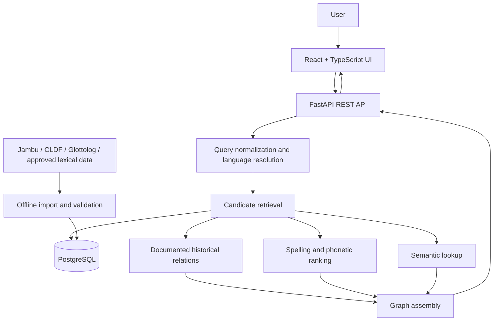

# Technical Architecture — Language Similarity Graph

## 1. Architecture goals

The initial architecture should be easy to develop, deploy, test, and explain in a portfolio. Use a conventional web frontend, a single API service, PostgreSQL, and a repeatable offline ingestion pipeline. Do not introduce microservices or a dedicated graph database until measured query patterns justify them.

## 2. Proposed stack

| Layer | Choice | Role |
|---|---|---|
| Frontend | React + TypeScript + Vite | UI, search, graph interactions |
| Styling | Tailwind CSS plus reusable components | Responsive visual system |
| Graph | Cytoscape.js | Nodes, edges, layouts, selection, expansion |
| API | Python + FastAPI + Pydantic | Query orchestration and validated JSON responses |
| Database | PostgreSQL | Lexical records, sources, relations, and indexed search |
| Fuzzy spelling retrieval | PostgreSQL `pg_trgm` initially | Indexed trigram similarity search |
| Import and validation | Python scripts; CLDF-compatible adapters where possible | Reproducible data ingestion |
| Tests | pytest + API tests + browser end-to-end tests | Correctness and regression testing |
| Deployment | Static frontend hosting + containerized API + managed PostgreSQL | Simple public demo deployment |

References: [Cytoscape.js](https://js.cytoscape.org/), [PostgreSQL `pg_trgm`](https://www.postgresql.org/docs/17/pgtrgm.html), [CLDF](https://cldf.clld.org/).

## 3. High-level components



## 4. Runtime query pipeline

1. Accept raw query and optional `language_id`.
2. Validate length, remove unsafe control characters, normalize Unicode to the selected canonical form (typically NFC), and preserve the original string.
3. Detect script and infer candidate languages if no language is specified.
4. Resolve exact native-form, alias, lemma, and supported transliteration matches.
5. Retrieve direct documented lexical relationships from indexed tables.
6. Retrieve spelling and phonetic candidates separately.
7. Retrieve semantic/concept links from stored lexical relations; optionally use a semantic model only if its use is justified and tested.
8. Rank candidates within their own categories.
9. Build a bounded local subgraph (default depth 1; optional depth 2) and deduplicate nodes/edges.
10. Return nodes, edges, warnings, and evidence metadata.

Do not let model-generated text become a source of record. Any model-assisted candidate should have a distinct algorithmic status.

## 5. Database model

The schema below is a starting point; adapt it after inspecting the actual CLDF/Jambu fields.

### `language`

- `id` — internal stable primary key
- `name`
- `iso_code` — nullable
- `glottocode` — nullable but unique when present
- `family_id` — nullable reference to a family/classification table
- `parent_language_id` — nullable classification parent, if appropriate
- `metadata_json`

### `script`

- `id`
- `name`
- `unicode_script`
- `transliteration_profile`

### `language_script`

- `language_id`
- `script_id`
- `is_primary`
- `source_id`

### `variety`

- `id`
- `language_id`
- `name`
- `region_description` — only if documented
- `source_id`

### `lexeme`

- `id`
- `language_id`
- `variety_id` — nullable
- `form`
- `normalized_form`
- `lemma` — nullable
- `ipa` — nullable
- `transliteration` — nullable
- `gloss` — nullable
- `reconstruction_status` — `attested`, `reconstructed`, `uncertain`, `unknown`
- `source_id`
- `source_record_id`

### `concept`

- `id`
- `label`
- `definition`
- `source_id`

### `lexeme_concept`

- `lexeme_id`
- `concept_id`
- `sense_note`
- `source_id`

### `relationship`

- `id`
- `source_lexeme_id`
- `target_lexeme_id`
- `type` — enum/reference table
- `direction` — `directed`, `undirected`, or `unknown`
- `status` — e.g. `documented`, `disputed`, `candidate`, `rejected`
- `source_id` — nullable only for explicitly algorithmic candidates
- `source_record_id`
- `method` — nullable; used for computed candidates
- `score` — nullable numeric score, never interpreted as etymological probability by default
- `notes`

### `source`

- `id`
- `title`
- `author_or_editor`
- `url`
- `publication_year`
- `version_or_release`
- `licence_name`
- `licence_url`
- `reuse_status` — `approved`, `attribution_required`, `restricted`, `unknown`, `excluded`
- `attribution_text`
- `notes`

### `evidence`

- `id`
- `relationship_id`
- `source_id`
- `citation`
- `locator` — page, entry ID, section, or URL fragment
- `evidence_note`

A later historical-text feature can add `text_work`, `text_edition`, and `attestation` tables with passage locator, date range, language/variety, source edition, and confidence in dating.

## 6. Relationship type vocabulary

Use controlled values instead of free-form relationship labels. A proposed initial vocabulary:

- `cognate`
- `inherited_form`
- `derived_form`
- `borrowed_from`
- `calque_or_loan_translation` (only when adequately documented)
- `reconstructed_ancestor_of`
- `orthographic_similarity_candidate`
- `phonetic_similarity_candidate`
- `semantic_equivalent`
- `semantic_relatedness_candidate`
- `language_classification_parent`

Do not treat `language_classification_parent` as an ordinary word-relationship edge. Keep the language-family hierarchy in a distinct graph or relationship namespace.

## 7. REST API proposal

### `GET /api/v1/search`

Parameters:

- `q` — required query string
- `language_id` — optional language hint
- `limit` — bounded integer, default 10

Returns exact/alias matches and possible language interpretations. Example response shape:

```json
{
  "query": "पानी",
  "normalized_query": "पानी",
  "language_hints": [],
  "matches": [
    {
      "lexeme_id": "lexeme-id",
      "form": "पानी",
      "language_id": "hi",
      "gloss": "water",
      "match_type": "exact"
    }
  ],
  "warnings": []
}
```

Values above are illustrative placeholders, not records guaranteed by the data source.

### `GET /api/v1/lexemes/{lexeme_id}`

Returns lexeme fields, language/script metadata, glosses, reconstruction status, and source records.

### `GET /api/v1/graph/{lexeme_id}`

Parameters: `depth`, `relationship_types`, `language_ids`, `evidence_status`, `limit_nodes`.

Returns:

```json
{
  "root_lexeme_id": "lexeme-id",
  "nodes": [],
  "edges": [],
  "truncated": false,
  "warnings": []
}
```

### `GET /api/v1/relationships/{relationship_id}`

Returns the full relationship, direction/status, score/method when relevant, and attached evidence/source metadata.

### `GET /api/v1/languages`

Returns enabled languages, scripts, family metadata, and coverage hints.

## 8. Frontend structure

Suggested project tree:

```text
frontend/
  src/
    app/
    components/
      SearchBar.tsx
      LanguagePicker.tsx
      GraphCanvas.tsx
      GraphLegend.tsx
      RelationshipFilters.tsx
      LexemeDetailsPanel.tsx
      EvidencePanel.tsx
      EmptyState.tsx
    pages/
      ExplorePage.tsx
    api/
      client.ts
      search.ts
      graph.ts
    types/
      language.ts
      lexeme.ts
      relationship.ts
    styles/
backend/
  app/
    main.py
    api/
      search.py
      lexemes.py
      graph.py
      relationships.py
    models/
    schemas/
    services/
      normalize.py
      language_resolution.py
      retrieval.py
      similarity.py
      graph_builder.py
    db/
    importers/
    tests/
data/
  raw/                 # do not commit restricted source data
  manifests/
  processed/
scripts/
  import_data.py
  validate_data.py
  build_benchmark.py
```

## 9. Graph behaviour

- Initial depth: one edge from the root.
- Expand adjacent nodes on demand; provide a clear loading indicator.
- Cap initial node count (for example 50 nodes) and let users expand/filter.
- Use deterministic node IDs derived from internal lexeme identifiers.
- Maintain edge direction for borrowings when a source supports the direction.
- Use line style plus color to encode relation type.
- Highlight the selected path and keep the evidence panel synchronized with selected node/edge.
- Include a tabular/list representation as an accessible fallback to the canvas.

## 10. Operational and security considerations

- Do not expose database credentials or private source files to the browser.
- Validate and bound query parameters; impose maximum result and graph sizes.
- Rate-limit public endpoints if needed.
- Add CORS rules for the deployed frontend origin.
- Keep source files with restricted licences out of public images, downloadable bundles, and database seeds.
- Store database migrations and data-import manifests in version control.
- Log query latency and errors without storing unnecessary personal information.
- Keep data source terms and attribution visible in repository documentation.

## 11. Deployment strategy

Use a static frontend host for the React build, a Dockerized FastAPI service, and managed PostgreSQL. Set configuration using environment variables. Run migrations and approved seed imports as release steps. Include a small public dataset slice so a fresh deployment can be reproduced without downloading restricted source material.
