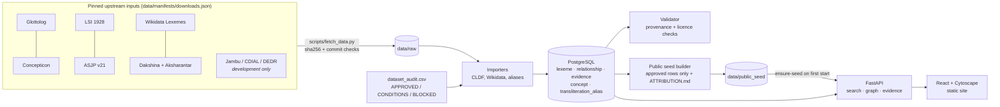

# Linguistic DNA: a technical write-up

*An evidence-first graph of how words in India's languages are related.*

## The problem

Word-history resources for South Asian languages are rich but hard to use. The best ones are printed dictionaries with dense abbreviations, and many of them are still under copyright. Meanwhile, the usual way people explore "related words" is visual resemblance, which is exactly what historical linguistics warns against.

This project asks a narrower, checkable question. Given a word, typed in any script, **what do cited sources say it is related to, and how do we know?**

## What it does

- **Search in 9 Brahmic scripts or romanisation.** पानी, "paani", *pānī* and ਪਾਣੀ all land on the same records. Each match says how it was found, for example "paani → पानी (dakshina) → pānī".
- **Typed, directed, cited links only.** Every edge reads as a sentence, such as "ਪਾਣੀ (Punjabi) comes from पाणीअ (Prakrit)". It opens to its evidence: the dataset, the record or statement ID, the page, and the source's licence.
- **Resemblance is kept apart.** Similar spellings are listed as candidates with a score that is explicitly not a relatedness measure. They are never drawn as edges.
- **Licensed data only in public.** A licence audit decides which datasets may be redistributed. The public seed is built mechanically from that audit, and a validator blocks anything else.

## Architecture

**Back end.** FastAPI, SQLAlchemy and Alembic on PostgreSQL 16 with `pg_trgm`. Every lexeme and relationship records the dataset it came from, and every source links to a row of the licence audit. The validator runs about 20 checks, which fall into three groups:
- **Data integrity:** dangling references, a documented edge without evidence, a starred form marked as attested, verbatim dictionary markup.
- **Licensing:** any row from a BLOCKED dataset, in public mode.
- **Form classification:** a stem or affix classified as a whole word.

**Front end.** React, TypeScript, Vite and Tailwind. Graph shaping (merging duplicate records, filters, neighbour capping, relation sentences) lives in a pure, unit-tested module. The canvas only draws.

## Design decisions worth explaining

1. **The licence audit is data, not prose.** `dataset_audit.csv` holds one row per dataset or separately licensed component. Each row records the exact file its licence was read from. Importers, the validator and the seed builder all read it. So "is this allowed in public?" is a query, and a new dataset cannot leak into the seed by accident.

2. **Licences are tracked per record when sources are mixed.** Aksharantar's transliteration pairs each name their source. For Hindi, 85% are mined from web text that AI4Bharat says it does not own; 31k come from Dakshina, which is CC BY-SA. The pipeline keeps only the manually collected pairs and the Wikidata-sourced pairs, and takes Dakshina from Dakshina directly, so its ShareAlike terms are honoured.

3. **No invented history.** LSI and ASJP have no cognate judgments for these languages, so they add words and meanings but no edges. Wikidata's "derived from" does not say whether a word was inherited or borrowed, so it is shown as "from", not as either. A source's own label is always kept beside the normalised type.

4. **One concept space.** Jambu's 3,321 concept IDs turned out to be Concepticon IDs (all matched on ID and gloss), so every dataset's words share one set of meanings.

5. **Our own romaniser.** Native-script search uses a rule-based ISO 15919 romaniser (about 300 lines, no external data) for the nine Brahmic blocks. It handles:
   - inherent-vowel deletion, which depends on the language rather than the script (Sanskrit *janaka*, Hindi *janak*);
   - anusvara read either as a nasal consonant or as a nasalised vowel (*dant* or *dā̃t*);
   - the Hunterian spellings of older sources (च as *ch*).

   Romanised queries reach native-only records because those records are keyed by their own romanisation.

6. **Whole words versus everything else.** A `form_kind` classification (word, stem, affix, root, compound, phrase) keeps *svatva-* (a stem) and *-ṭa-* (a suffix) out of the exact matches for "svatva".

## Testing

- **Backend (pytest against PostgreSQL), 74 tests:**
  - importer behaviour, ID stability across re-imports, and a sentinel proving verbatim dictionary text is never stored;
  - a seed that, built from a mixed database, contains only approved data and passes public-mode validation on a fresh load;
  - a multilingual regression suite with one native-script query for each of the 19 modern languages.
- **Frontend (Vitest), 12 tests.**
- **Benchmark:** 22 hand-picked relationship and lookup cases. They pass, but are marked unreviewed until a linguist signs off.
- **CI:** all of the above on every push.

## Limitations

- **The big gap is CDIAL and DEDR.** The two dictionaries behind most documented Indo-Aryan and Dravidian word histories are not in the public data until reuse permission is established. The public graph is therefore much thinner than the development database.
- **Wikidata is crowd-sourced.** Its claims are shown with their references, and some are doubtful.
- **Coverage is uneven.** Malayalam has 67k Wikidata lexemes; several languages have only 40–220-word wordlists.
- **Not yet handled:** Perso-Arabic, Ol Chiki and Meitei Mayek scripts, which is why Urdu, Kashmiri, Sindhi, Santali and Manipuri are not yet searchable.

## Numbers

From the public seed in `data/public_seed` (14 MB compressed), which passes all 21 validator checks in public mode on a fresh load:

| | |
|---|---:|
| Languages configured | 25 (19 modern in 3 families, 6 historical or reference layers) |
| Words | 98,916 |
| Cited relationships, each with evidence | 9,413 |
| of which "from" (Wikidata P5191) | 4,000 |
| of which "combines" (Wikidata P5238) | 5,413 |
| Transliteration spelling pairs | 947,189 |
| Concepts shared across wordlists | 169 |
| Datasets in the seed, all approved by the audit | 8 |
| Benchmark cases passing (unreviewed) | 22 / 22 |

Coverage per language is very uneven:

- **Large:** Malayalam 67,838 words, Bengali 12,662, Punjabi 4,227, Hindi 3,404.
- **Small:** the eight Tier 1 languages each have 73–363 words, almost all from LSI and ASJP wordlists.

The development database, which also holds the restricted Jambu import, has about 350k more words and 221k more relationships, none of which are published.
