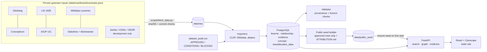

# Linguistic DNA: a technical write-up

*An evidence-first graph of how words in India's languages are related.*

## The problem

Word-history resources for South Asian languages are rich but hard to use. The best ones are printed dictionaries with dense abbreviations, and many of them are still under copyright. Meanwhile, the usual way people explore "related words" is visual resemblance, which is exactly what historical linguistics warns against.

This project asks a narrower, checkable question. Given a word, typed in any script, **what do cited sources say it is related to, and how do we know?**

## What it does

- **Search in 9 Brahmic scripts or romanisation.** पानी, "paani", *pānī* and ਪਾਣੀ all land on the same records. Each match says how it was found, for example "paani → पानी (dakshina) → pānī".
- **Typed, directed, cited links only.** Every edge reads as a sentence, such as "ਪਾਣੀ (Punjabi) comes from पाणीअ (Prakrit)". It opens to its evidence: the dataset, the record or statement ID, the page, and the source's licence.
- **Resemblance is kept apart.** Similar spellings are listed as candidates with a score that is explicitly not a relatedness measure. They are never drawn as edges.
- **Licensed data only in public.** A licence audit decides which datasets may be redistributed. The public seed is built mechanically from that audit, and a validator blocks anything else.

## Architecture

**Back end.** FastAPI, SQLAlchemy and Alembic on PostgreSQL 16 with `pg_trgm`. Every lexeme and relationship records the dataset it came from, and every source links to a row of the licence audit. The validator runs about 20 checks, which fall into three groups:
- **Data integrity:** dangling references, a documented edge without evidence, a starred form marked as attested, verbatim dictionary markup.
- **Licensing:** any row from a BLOCKED dataset, in public mode.
- **Form classification:** a stem or affix classified as a whole word.

**Front end.** React, TypeScript, Vite and Tailwind. Graph shaping (merging duplicate records, filters, neighbour capping, relation sentences) lives in a pure, unit-tested module. The canvas only draws.

## Design decisions worth explaining

1. **The licence audit is data, not prose.** `dataset_audit.csv` holds one row per dataset or separately licensed component. Each row records the exact file its licence was read from. Importers, the validator and the seed builder all read it. So "is this allowed in public?" is a query, and a new dataset cannot leak into the seed by accident.

2. **Licences are tracked per record when sources are mixed.** Aksharantar's transliteration pairs each name their source. For Hindi, 85% are mined from web text that AI4Bharat says it does not own; 31k come from Dakshina, which is CC BY-SA. The pipeline keeps only the manually collected pairs and the Wikidata-sourced pairs, and takes Dakshina from Dakshina directly, so its ShareAlike terms are honoured.

3. **No invented history.** LSI and ASJP have no cognate judgments for these languages, so they add words and meanings but no edges. Wikidata's "derived from" does not say whether a word was inherited or borrowed, so it is shown as "from", not as either. A source's own label is always kept beside the normalised type.

4. **One concept space.** Jambu's 3,321 concept IDs turned out to be Concepticon IDs (all matched on ID and gloss), so every dataset's words share one set of meanings.

5. **Our own romaniser.** Native-script search uses a rule-based ISO 15919 romaniser (about 300 lines, no external data) for the nine Brahmic blocks. It handles:
   - inherent-vowel deletion, which depends on the language rather than the script (Sanskrit *janaka*, Hindi *janak*);
   - anusvara read either as a nasal consonant or as a nasalised vowel (*dant* or *dā̃t*);
   - the Hunterian spellings of older sources (च as *ch*).

   Romanised queries reach native-only records because those records are keyed by their own romanisation.

6. **Whole words versus everything else.** A `form_kind` classification (word, stem, affix, root, compound, phrase) keeps *svatva-* (a stem) and *-ṭa-* (a suffix) out of the exact matches for "svatva".

## Testing

- **Backend (pytest against PostgreSQL), 91 tests:**
  - importer behaviour, ID stability across re-imports, and a sentinel proving verbatim dictionary text is never stored;
  - a seed that, built from a mixed database, contains only approved data and passes public-mode validation on a fresh load;
  - a multilingual regression suite with one native-script query for each of the 19 modern languages.
- **Frontend (Vitest), 13 tests.**
- **Benchmark:** 22 hand-picked relationship and lookup cases. They pass, but are marked unreviewed until a linguist signs off.
- **CI:** all of the above on every push.

## Limitations

- **Open versus research data.** The richest word-history sources, CDIAL and DEDR (through Jambu), Monier-Williams, the Digital Pāḷi Dictionary and the StarLing etymological databases (Pokorny, Vasmer, Altaic and other families), have no open or only a non-commercial licence. They are used in the research database, cited on every record, but are not in the downloadable open dataset, which is therefore thinner.
- **Crowd-sourced data.** Wikidata and Wiktionary claims are shown with their references, and some are doubtful.
- **Coverage is uneven.** Sanskrit has 441k words; Bodo has 442.
- **Not yet handled:** Perso-Arabic, Ol Chiki and Meitei Mayek scripts, which is why Urdu spellings, Kashmiri, Sindhi, Santali and Manipuri are not yet searchable natively.

## Numbers

As of 2026-10-30.

| | Open public seed | Research database, South Asia phase | Research database, after the global expansion |
|---|---:|---:|---:|
| Words | 521,448 | 1,812,733 | 8,480,391 |
| Cited relationships, each with evidence | 221,594 | 996,776 | 4,560,323 |
| Transliteration spelling pairs | 947,189 | 947,189 | 947,189 |
| Searchable languages | 25 | 25 | 3,489 |
| Datasets | 15 (14 sources; Aksharantar counts twice) | 19 (adds Jambu, Monier-Williams, DPD and Peiros) | 147 with words or profiles (adds 130 Lexibank wordlists, 32 wordnets, WALS, PHOIBLE, Wiktionary's English, Germanic and steppe languages) |
| Size | about 55 MB compressed, 680 MB loaded | about 2.2 GB | about 9.8 GB |

The global expansion and the steppe corridor are described in [DATASET_LICENCE_AUDIT.md](DATASET_LICENCE_AUDIT.md) § 4b, and the StarLing databases in § 4c; StarLing is imported on the user's own machine and is not in these counts. `make full-db` adds Wiktionary and Wikidata in every language.

- **Open seed:** passes all 25 public-mode validator checks on a fresh load.
- **Research database:** passes `validate --research`, so every research-use record cites a source.
- **Benchmark:** all 22 cases pass; they are still unreviewed.
- **Datasets:** the per-dataset table is in [DATASET_LICENCE_AUDIT.md](DATASET_LICENCE_AUDIT.md), section 4a.
